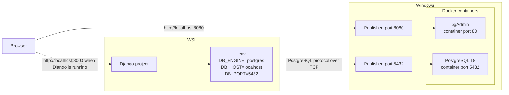

# Cell Project - ERP for Cell Church Management


**Cell Project** is an ERP system developed for managing churches organized under the cell model. The initial focus is on the Youth Ministry (Mag) administration, with architecture prepared for future expansion to other church areas.

> **⚠️ Current Phase:** The project is in its **early days of development**. Backend structuring, data modeling, and environment setup are currently in progress.

---

## 👥 Team

| Name | Role | Primary Stack |
|------|------|---------------|
| **Lucas Oliveira** | Backend Developer | Django, DRF, PostgreSQL |
| **Leandro Finochio** | Frontend Developer | Angular, TypeScript |
| **Guilherme Gomes** | Data Analyst | Python, Pandas, Jupyter, PowerBI |

---

## 🛠️ Tech Stack

### Backend
- **Framework:** Django 5.0 + Django REST Framework
- **Database:** PostgreSQL (via `psycopg2-binary`)
- **Authentication:** JWT (Simple JWT)
- **Data Validation:** Pydantic
- **Dependency Management:** Poetry 2.0

### Frontend
- **Framework:** Angular
- **Communication:** HTTP Client for REST API consumption

### Data Analysis
- **Libraries:** Pandas, NumPy
- **Visualization:** To be defined (Matplotlib/Seaborn/Power BI)

### Development Tools
- **Documentation:** MkDocs + Material + **Qwen CLI** (docs and testing assistance)
- **Testing:** Pytest + Pytest-Django + **Qwen CLI**
- **Linting/Formatting:** Ruff
- **AI Integration:** OpenAI API

---

## 📦 Core Dependencies

### Production
```
django>=5.0.1
djangorestframework>=3.15.1
djangorestframework-simplejwt>=5.3.1
psycopg2-binary>=2.9.10
python-dotenv>=1.1.1
openai>=1.97.0
pydantic>=2.10.6
pyjwt>=2.10.1
mkdocs>=1.6.1
mkdocs-material>=9.6.20
```

### Development
```
ruff>=0.12.7
taskipy>=1.14.1
pytest-django>=4.8.0
pytest-cov>=5.0
flake8>=7.0.0
pandas>=2.0.0
```

---

## 🚀 Installation and Setup (Development Environment)

### Prerequisites
- Python 3.13
- Poetry 2.0+
- PostgreSQL 14+
- Node.js 18+ (for Angular frontend)
- Git

### Backend Setup Steps

1. **Clone the repository**
   ```bash
   git clone <repository-url>
   cd cell_project
   ```

2. **Configure Python environment with Poetry**
   ```bash
   poetry env use 3.13
   poetry install
   ```

3. **Activate the virtual environment**
   ```bash
   poetry shell
   ```

4. **Configure environment variables**
   
   Create a `.env` file in the project root:
   ```ini
   # Django
   SECRET_KEY=your-super-secure-secret-key-here
   DEBUG=True
   ALLOWED_HOSTS=localhost,127.0.0.1
   
   # Database (same values used by compose.yaml)
   DB_ENGINE=postgres
   DB_NAME=cell_db
   DB_USER=cell_user
   DB_PASSWORD=cell_password
   DB_HOST=localhost
   DB_PORT=5432
   
   # OpenAI (for AI features)
   OPENAI_API_KEY=your-openai-key
   
   # JWT
   JWT_SECRET_KEY=your-jwt-key
   ```

5. **Start PostgreSQL in Docker**
   ```bash
   cp .env.example .env
   docker compose up -d db
   ```

6. **Create the schema in PostgreSQL**
   ```bash
   python manage.py migrate
   ```

7. **Create a Django superuser**
   ```bash
   python manage.py createsuperuser
   ```

8. **Start the development server**
   ```bash
   python manage.py runserver
   ```

### Local Development Infrastructure (WSL + Docker on Windows)

The Django project runs from WSL, while PostgreSQL and pgAdmin run in Docker
on Windows. Docker publishes PostgreSQL on port `5432` and pgAdmin on port
`8080`; WSL reaches PostgreSQL through `localhost:5432`.



Open pgAdmin at `http://localhost:8080`. PostgreSQL uses port `5432` for
database clients such as Django and `psql`; it is not an HTTP page for the
browser.

### Import existing SQLite data

Keep a copy of `db.sqlite3` in the project root before starting. With `.env`
configured for PostgreSQL and the container running, export the SQLite records,
then load them into PostgreSQL:

```bash
DB_ENGINE=sqlite python manage.py dumpdata \
  --exclude contenttypes --exclude auth.permission \
  --exclude admin.logentry --exclude sessions --indent 2 > sqlite_backup.json
python manage.py migrate
python manage.py loaddata sqlite_backup.json
```

Check the imported records in Django admin or the application before deleting
the backup fixture or the original SQLite file. To roll back locally, set
`DB_ENGINE=sqlite` in `.env`; the SQLite file is left untouched.
   
   The API will be available at: `http://localhost:8000/api/`

---

## 🖥️ Angular Frontend (Development)

### Initial Setup

1. **Navigate to the frontend folder**
   ```bash
   cd frontend
   ```

2. **Install dependencies**
   ```bash
   npm install
   ```

3. **Configure environment**
   
   Create the file `src/environments/environment.ts`:
   ```typescript
   export const environment = {
     production: false,
     apiUrl: 'http://localhost:8000/api'
   };
   ```

4. **Start Angular development server**
   ```bash
   ng serve
   ```
   
   The application will be available at: `http://localhost:4200/`

---

## 📊 Data Analysis with Pandas

Data analysis scripts are located in the `analytics/` folder.

### Usage example:
```python
import pandas as pd
from django_pandas.io import read_frame

# Export attendance data for analysis
from cell_project.members.models import MonthlyAttendance

qs = MonthlyAttendance.objects.filter(reference_month__year=2026)
df = read_frame(qs)

# Analysis with Pandas
average_attendance = df.groupby('cell_id')['percentage'].mean()
```

### Jupyter Notebooks
To run interactive analyses:
```bash
poetry run jupyter notebook
```

---

## 🤖 Qwen CLI - Documentation and Testing Assistant

**Qwen CLI** accelerates development through:

- Automatic docstring generation
- Test case suggestions
- Documentation review
- Unit test writing assistance

### Useful commands:

```bash
# Generate docstring for a function
qwen docstring "def calculate_attendance(month, attendances):"

# Suggest tests for a Django model
qwen suggest-tests "class Cell(models.Model):"

# Review MkDocs documentation
qwen review-docs docs/
```

> **Note:** Ensure Qwen CLI is installed and configured with your API key.

---

## 📋 Quick Commands (Taskipy)

| Command | Description |
|---------|-------------|
| `poetry run task lint` | Run code checks with Ruff |
| `poetry run task format` | Auto-format code |
| `poetry run task test` | Run test suite with coverage |
| `poetry run task docs` | Start MkDocs server at `127.0.0.1:8001` |

---

## 📁 Project Structure (Overview)

```
cell_project/
├── app/                                     # Main Django application
│   ├── asgi.py
│   ├── basemodel.py                         # Base model with common fields
│   ├── settings.py                          # Main settings file
│   ├── templates/                           # Main templates
│   │   ├── base.html                        # Base HTML template
│   │   ├── components/                      # Reusable template components
│   │   │   ├── _dashboard_metrics.html      # Dashboard metrics component
│   │   │   ├── _footer.html                 # Footer component
│   │   │   ├── _header.html                 # Header component
│   │   │   └── _sidebar.html                # Sidebar navigation
│   │   └── dashboard.html                   # Dashboard page
│   ├── urls.py                              # Main URL routing
│   ├── views.py                             # Dashboard and main views
│   └── wsgi.py
├── areas/                                   # Geographic areas management
│   ├── admin.py
│   ├── apps.py
│   ├── forms.py
│   ├── models.py
│   ├── templates/
│   │   ├── area_detail.html
│   │   └── area_list.html
│   ├── urls.py
│   └── views.py
├── calendar_events/                         # Calendar events management
│   ├── admin.py
│   ├── apps.py
│   ├── forms.py
│   ├── models.py
│   ├── templates/
│   │   ├── calendar_event_create.html
│   │   ├── calendar_event_delete.html
│   │   ├── calendar_event_detail.html
│   │   ├── calendar_event_list.html
│   │   └── calendar_event_update.html
│   ├── urls.py
│   └── views.py
├── cell_locations/                          # Physical meeting locations
│   ├── admin.py
│   ├── apps.py
│   ├── forms.py
│   ├── models.py
│   ├── templates/
│   │   ├── cell_location_create.html
│   │   ├── cell_location_delete.html
│   │   ├── cell_location_detail.html
│   │   ├── cell_location_list.html
│   │   └── cell_location_update.html
│   ├── urls.py
│   └── views.py
├── cell_meetings/                           # Cell meeting records
│   ├── admin.py
│   ├── apps.py
│   ├── forms.py
│   ├── models.py
│   ├── templates/
│   │   ├── cell_meeting_create.html
│   │   ├── cell_meeting_delete.html
│   │   ├── cell_meeting_detail.html
│   │   ├── cell_meeting_list.html
│   │   └── cell_meeting_update.html
│   ├── urls.py
│   └── views.py
├── cell_members/                            # Cell membership management
│   ├── admin.py
│   ├── apps.py
│   ├── forms.py
│   ├── models.py
│   ├── templates/
│   │   ├── cell_member_create.html
│   │   ├── cell_member_delete.html
│   │   ├── cell_member_detail.html
│   │   ├── cell_member_list.html
│   │   └── cell_member_update.html
│   ├── urls.py
│   └── views.py
├── cell_project/                            # Project configuration directory
├── cells/                                   # Cell groups management
│   ├── admin.py
│   ├── apps.py
│   ├── forms.py
│   ├── models.py
│   ├── templates/
│   │   ├── cell_create.html
│   │   ├── cell_delete.html
│   │   ├── cell_detail.html
│   │   ├── cell_list.html
│   │   └── cell_update.html
│   ├── templatetags/                        # Custom template tags
│   │   └── cell_tags.py                     # Cell-related template tags
│   ├── urls.py
│   └── views.py
├── event_types/                             # Event type definitions
│   ├── admin.py
│   ├── apps.py
│   ├── forms.py
│   ├── models.py
│   └── views.py
├── hosts/                                   # Meeting hosts management
│   ├── admin.py
│   ├── apps.py
│   ├── forms.py
│   ├── models.py
│   ├── templates/
│   │   ├── host_create.html
│   │   ├── host_delete.html
│   │   ├── host_detail.html
│   │   ├── host_list.html
│   │   └── host_update.html
│   ├── urls.py
│   └── views.py
├── leadership_roles/                        # Leadership role definitions
│   ├── admin.py
│   ├── apps.py
│   ├── forms.py
│   ├── models.py
│   └── views.py
├── leaderships/                             # Leadership assignments
│   ├── admin.py
│   ├── apps.py
│   ├── forms.py
│   ├── models.py
│   ├── templates/
│   │   ├── leadership_create.html
│   │   ├── leadership_delete.html
│   │   ├── leadership_detail.html
│   │   ├── leadership_list.html
│   │   └── leadership_update.html
│   ├── urls.py
│   └── views.py
├── mag_branches/                            # MAG branch management
│   ├── admin.py
│   ├── apps.py
│   ├── models.py
│   └── views.py
├── manage.py                                # Django management script
├── meeting_attendances/                     # Individual meeting attendance
│   ├── admin.py
│   ├── apps.py
│   ├── forms.py
│   ├── models.py
│   ├── templates/
│   │   ├── meeting_attendance_create.html
│   │   ├── meeting_attendance_delete.html
│   │   ├── meeting_attendance_detail.html
│   │   ├── meeting_attendance_list.html
│   │   └── meeting_attendance_update.html
│   ├── urls.py
│   └── views.py
├── member_ministries/                       # Member ministry participation
│   ├── admin.py
│   ├── apps.py
│   ├── forms.py
│   ├── models.py
│   ├── templates/
│   │   ├── member_ministry_create.html
│   │   ├── member_ministry_delete.html
│   │   ├── member_ministry_detail.html
│   │   ├── member_ministry_list.html
│   │   └── member_ministry_update.html
│   ├── urls.py
│   └── views.py
├── members/                                 # Church members management
│   ├── admin.py
│   ├── apps.py
│   ├── forms.py
│   ├── models.py
│   ├── templates/
│   │   ├── member_create.html
│   │   ├── member_delete.html
│   │   ├── member_detail.html
│   │   ├── member_list.html
│   │   └── member_update.html
│   ├── urls.py
│   └── views.py
├── ministries/                              # Ministry definitions
│   ├── admin.py
│   ├── apps.py
│   ├── forms.py
│   ├── models.py
│   └── views.py
├── monthly_attendances/                     # Monthly attendance reports
│   ├── admin.py
│   ├── apps.py
│   ├── forms.py
│   ├── models.py
│   ├── templates/
│   │   ├── monthly_attendance_detail.html
│   │   └── monthly_attendance_list.html
│   ├── urls.py
│   └── views.py
├── person/                                  # Person core model
│   ├── admin.py
│   ├── apps.py
│   ├── forms.py
│   ├── models.py
│   ├── templates/
│   │   ├── person_create.html
│   │   ├── person_delete.html
│   │   ├── person_detail.html
│   │   ├── person_list.html
│   │   └── person_update.html
│   ├── urls.py
│   └── views.py
├── poetry.lock                              # Poetry lock file
├── pyproject.toml                           # Poetry configuration
├── requirements.txt                         # Python dependencies
└── visitors/                                # Visitor tracking
    ├── admin.py
    ├── apps.py
    ├── forms.py
    ├── models.py
    ├── templates/
    │   ├── visitor_create.html
    │   ├── visitor_delete.html
    │   ├── visitor_detail.html
    │   ├── visitor_list.html
    │   └── visitor_update.html
    ├── urls.py
    └── views.py
```

---

## 🧪 Testing

### Run all tests
```bash
poetry run task test
```

### Run specific tests
```bash
poetry run pytest apps/members/tests/
```

### Generate HTML coverage report
```bash
poetry run pytest --cov=cell_project --cov-report=html
# Open htmlcov/index.html in your browser
```

---

## 📈 Development Roadmap

| Phase | Task | Owner | Status |
|-------|------|-------|--------|
| **1 - Foundation** | Poetry and Django environment setup | Lucas Oliveira | ✅ Completed |
| **1 - Foundation** | Tech stack definition | Lucas Oliveira | ✅ Completed |
| **1 - Foundation** | Data modeling | Lucas Oliveira | ✅ Completed |
| **2 - Frontend Base (Provisional)** | Base template creation (Bootstrap) | Lucas Oliveira | ✅ Completed |
| **2 - Frontend Base (Provisional)** | Components creation (Bootstrap) | Lucas Oliveira | ✅ Completed |
| **2 - Frontend Base (Provisional)** | Domain layer validation | Lucas Oliveira | ✅ Completed |
| **3 - Admin & CRUD** | Domain admin creation | Lucas Oliveira | ✅ Completed |
| **3 - Admin & CRUD** | CRUD: Read - Domain list | Lucas Oliveira | ✅ Completed |
| **3 - Admin & CRUD** | Domain filters | Lucas Oliveira | ✅ Completed |
| **3 - Admin & CRUD** | CRUD: Create - Domain creation | Lucas Oliveira | ✅ Completed |
| **3 - Admin & CRUD** | Domain forms styling | Lucas Oliveira | ✅ Completed |
| **3 - Admin & CRUD** | CRUD: Read - Domain details | Lucas Oliveira | ✅ Completed |
| **3 - Admin & CRUD** | Domain action menu | Lucas Oliveira | ✅ Completed |
| **3 - Admin & CRUD** | CRUD: Update - Domain update | Lucas Oliveira | ✅ Completed |
| **3 - Admin & CRUD** | CRUD: Delete - Domain deletion | Lucas Oliveira | ✅ Completed |
| **3 - Admin & CRUD** | Pagination implementation | Lucas Oliveira | ✅ Completed |
| **4 - Data Population & Provisional Reports** | Populate database with sample data | Lucas Oliveira | 🔄 In Progress |
| **4 - Data Population & Provisional Reports** | Create provisional report screens (Bootstrap) | Lucas Oliveira | 🔄 In Progress |
| **4 - Data Population & Provisional Reports** | Create monthly cell member attendance screen | Lucas Oliveira | 🔄 In Progress |
| **5 - Data Analysis (Parallel)** | Data analysis with Pandas | Guilherme | 🔄 In Progress |
| **5 - Data Analysis (Parallel)** | Generate charts and visualizations | Guilherme | 🔄 In Progress |
| **6 - Frontend Definitive (Parallel)** | Angular project setup | Leandro | 🔄 In Progress |
| **6 - Frontend Definitive (Parallel)** | Definitive UI/UX design implementation | Leandro | 🔄 In Progress |
| **6 - Frontend Definitive (Parallel)** | Angular components and screens creation | Leandro | 🔄 In Progress |
| **7 - Authentication & Permissions** | Login route creation | Lucas Oliveira | ⏳ Pending |
| **7 - Authentication & Permissions** | Login screen creation | Lucas Oliveira | ⏳ Pending |
| **7 - Authentication & Permissions** | User authentication implementation | Lucas Oliveira | ⏳ Pending |
| **7 - Authentication & Permissions** | Logout implementation | Lucas Oliveira | ⏳ Pending |
| **7 - Authentication & Permissions** | User permissions | Lucas Oliveira | ⏳ Pending |
| **7 - Authentication & Permissions** | User groups and permissions | Lucas Oliveira | ⏳ Pending |
| **7 - Authentication & Permissions** | Dynamic interface based on permissions | Lucas Oliveira | ⏳ Pending |
| **8 - API** | Domain API creation | Lucas Oliveira | ⏳ Pending |
| **8 - API** | JWT API authentication | Lucas Oliveira | ⏳ Pending |
| **8 - API** | API authentication and permissions | Lucas Oliveira | ⏳ Pending |
| **9 - Integration** | Integrate Pandas reports into Django | Lucas Oliveira + Guilherme | ⏳ Pending |
| **9 - Integration** | Integrate Angular frontend with Django API | Lucas Oliveira + Leandro | ⏳ Pending |
| **10 - Final Adjustments** | Final adjustments and best practices | Team | ⏳ Pending |

**Legend:** ✅ Completed | 🔄 In Progress | ⏳ Pending

---

## 🤝 Contributing

### Git Workflow

1. **Always create a branch from `develop`**
   ```bash
   git checkout develop
   git pull origin develop
   git checkout -b feature/feature-name
   ```

2. **Commit convention (Conventional Commits)**
   ```
   feat: add Cell model
   fix: correct attendance calculation
   docs: update README
   test: add tests for Members
   refactor: reorganize folder structure
   ```

3. **Before opening a Pull Request**
   ```bash
   poetry run task lint
   poetry run task format
   poetry run task test
   ```

---

## 📝 Development Notes

### For Backend Team (Lucas)
- Keep `poetry.lock` versioned
- Update `requirements.txt` before deployments:
  ```bash
  poetry export -f requirements.txt --output requirements.txt --without-hashes
  ```

### For Frontend Team (Leandro)
- Consume API at `http://localhost:8000/api/`
- Interactive documentation available at `http://localhost:8000/api/docs/`

### For Data Analysis (Guilherme)
- Data exportable via Django REST Framework or direct SQL
- Jupyter notebooks in `analytics/notebooks/`
- Shared environment via Poetry (include `pandas` in dev group)

---

## 📄 License

This project is under the MIT License. See the `LICENSE` file for more details.

---

## 📞 Contact

| Role | Name | Email |
|------|------|-------|
| Backend Lead | Lucas Oliveira | lucas.oliveira.profissional@hotmail.com |
| Frontend Lead | Leandro Finochio | - |
| Data Lead | Guilherme Gomes | - |
